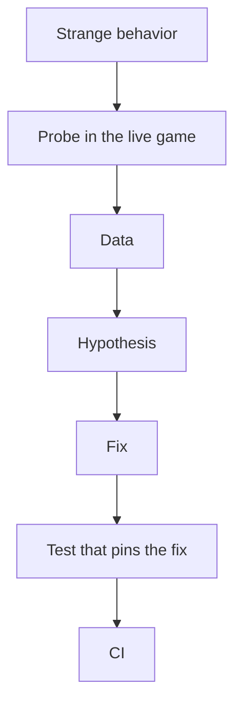

## Table of contents

## Introduction

Every test is green, and a car slams on the brakes in the middle of an empty junction. It doesn't happen every time, only once every few minutes and only with twenty cars on screen. The car-following model, the lane graph and the traffic lights all have tests, all of them pass, and the car stops anyway.

This is a classic hard-to-reproduce bug, and unit testing can't help with it, because nobody knows what to assert yet. You aren't asking whether the braking formula is right. You're asking what this car sees in the frame it decides to brake. To find out, you add a **probe**: a few lines in the running game that write down what the car sees.

Probes vs tests in Unity is a question of timing: probes are for finding bugs your tests can't see, tests are for keeping them fixed. Both run code to check code, so people mix them up, even though they answer different questions and have very different lifespans. This post covers where the word comes from, what probes look like in Unity, how they compare with Edit Mode and Play Mode tests in the Unity Test Framework, and how a probe turns into a regression test once it has found the bug.

## One word, many meanings

"Probe" means several things, so first, what this post is *not* about.

- Light Probes and Reflection Probes in Unity are rendering features. They sample lighting at points in space so dynamic objects get correct light and reflections, and they have nothing to do with checking code.
- Physics probes are the raycasts, sphere casts and overlap checks an AI uses to feel the world around it (is there ground ahead, is there a wall to the left). They're sensors, part of the game itself.
- Oscilloscope probes are the closest picture of what this post means. An engineer touches a wire to read the voltage without cutting the circuit.

That last one is the sense used here. In software, a probe is a **point of observation attached to a running system**, the smallest unit of runtime instrumentation. It doesn't change behavior and it doesn't decide pass or fail. It tells you what's happening.

## Probes outside games

Two fields use the word officially.

Kubernetes calls its health checks probes: liveness, readiness and startup probes. On a schedule, the cluster asks a running container whether it's alive, whether it's ready for traffic and whether it has finished starting.

```yaml file=deployment.yaml
livenessProbe:
  httpGet:
    path: /healthz
    port: 8080
  periodSeconds: 10
  failureThreshold: 3
readinessProbe:
  httpGet:
    path: /ready
    port: 8080
  periodSeconds: 5
startupProbe:
  httpGet:
    path: /healthz
    port: 8080
  failureThreshold: 30
  periodSeconds: 10
```

Nobody wrote these probes to prove the code is correct. The code passed its tests in CI hours ago. The probes are there because a correct program can still hang on a dead database connection at 3 a.m., and only something watching the live process will notice.

eBPF and DTrace go further. A `uprobe` attaches to any function in a running binary and fires on every call, without a recompile or a restart:

```bash
bpftrace -e 'uprobe:/usr/bin/bash:readline { printf("readline in pid %d\n", pid); }'
```

The program has no idea it's being watched. You ask it a question from outside, read the answer and detach.

## Probes vs tests: question versus assertion

**A test asserts an answer. A probe asks a question.** The test's answer is one you already know; the probe's question is one you can't answer yet.

A test says "given this input, the function returns 42", and you wrote the 42 before running anything. A probe asks "what does the function return on frame 3812 in this scene?", and you learn the answer when you run it. The rest of the table follows from that difference.

| | Test | Probe |
| --- | --- | --- |
| Purpose | Prevent regressions | Find out what's happening |
| Output | Pass or fail | Data: numbers, logs, traces |
| Environment | Isolated, controlled, repeatable | The live scene with real content and real timing |
| Expected result | Known in advance | Unknown, which is why you run it |
| Lifetime | Permanent, runs in CI | Usually temporary, sometimes permanent monitoring |
| Verdict | Built in: red means the code broke | Left to the reader, or to a threshold like Kubernetes' `failureThreshold` |
| Who reads it | A machine | A human (or an agent) |



The probe starts the loop, while you still don't understand the problem. The test ends it, once you understand the problem well enough to write down the right answer. Mixing them up costs you: a test written too early asserts the wrong thing, and a probe left in place of a test won't catch the bug when it comes back.

## Why unit testing games falls short

In a web backend, most logic depends only on its input: send the endpoint a request, check the response. Games break that assumption in several ways, which weakens classic unit tests and makes intermittent bugs more common.

- Behavior emerges from interaction. Twenty cars that each pass their tests can still produce a traffic jam that no single car is responsible for.
- Time is part of the input. Frame rate, `Time.deltaTime` and the order in which `Update` runs across objects all matter, so a bug that shows up at 30 fps under load won't reproduce in a test running at a fixed step.
- Physics isn't fully deterministic. The same scene can resolve a collision differently across runs and platforms.
- A lot of the game lives in content, not code. A spawn point half a meter off the NavMesh, a collider on the wrong layer or a lane connected the wrong way in the editor are all bugs, and no test of your C# will find a bug that lives in a scene file.
- "Correct" is often fuzzy. You can't assert that the AI looks natural. You can assert that it brakes at 3.2 m/s² on average, but only after a probe has shown you what natural braking looks like in numbers.

So in gamedev the usual ratio flips: fewer automated tests than a backend team would write, and many more probes. QA attacks the same gap from its side with exploratory testing, where a person plays without a script to find what nobody thought to test. A probe is the programmer's version of that, an unscripted question put to the live game.

## Debugging in Unity with probes

A probe in Unity is a small piece of code that watches the editor or the running game and reports back. It usually takes one of four forms.

### Editor probe: ask the scene

The quickest probe never enters Play mode. It walks the open scene and checks the content.

```csharp file=Editor/SpawnPointProbe.cs
using UnityEditor;
using UnityEngine;
using UnityEngine.AI;

public static class SpawnPointProbe
{
    [MenuItem("Tools/Probes/Spawn points off NavMesh")]
    private static void Run()
    {
        var points = Object.FindObjectsByType<SpawnPoint>(FindObjectsSortMode.None);
        int off = 0;

        foreach (var p in points)
        {
            if (NavMesh.SamplePosition(p.transform.position, out var hit, 0.5f, NavMesh.AllAreas))
                continue;

            off++;
            Debug.Log($"[probe] {p.name} at {p.transform.position} is off the NavMesh", p);
        }

        Debug.Log($"[probe] {off} of {points.Length} spawn points are off the NavMesh");
    }
}
```

The second argument of `Debug.Log` is the context object. When you click the console entry, Unity selects the broken spawn point in the hierarchy, so the probe takes you straight to the problem.

The probe doesn't throw an exception or fix anything. It reports `7 of 312`, and you decide whether those are seven bugs or seven decorative spawn points on rooftops.

### Play mode probe: record over time

Most interesting bugs only appear while things move. A play mode probe is a component you attach to an object to record what it does, frame by frame.

```csharp file=BrakeProbe.cs
using System.IO;
using System.Text;
using UnityEngine;

public class BrakeProbe : MonoBehaviour
{
    [SerializeField] private float decelThreshold = 4f;

    private CarController car;
    private float lastSpeed;
    private readonly StringBuilder log = new StringBuilder("frame,time,speed,decel,leader,gap\n");

    private void Awake() => car = GetComponent<CarController>();

    private void FixedUpdate()
    {
        float speed = car.Speed;
        float decel = (lastSpeed - speed) / Time.fixedDeltaTime;
        lastSpeed = speed;

        if (decel < decelThreshold) return;

        var leader = car.Leader;
        log.Append(Time.frameCount).Append(',')
           .Append(Time.time.ToString("F2")).Append(',')
           .Append(speed.ToString("F2")).Append(',')
           .Append(decel.ToString("F2")).Append(',')
           .Append(leader ? leader.name : "none").Append(',')
           .Append(car.GapToLeader.ToString("F2")).Append('\n');
    }

    private void OnDisable()
    {
        string path = Path.Combine(Application.persistentDataPath, $"brake_{name}.csv");
        File.WriteAllText(path, log.ToString());
        Debug.Log($"[probe] wrote {path}");
    }
}
```

Run the scene for five minutes, open the CSV and sort by `decel`. For the car from the introduction, the answer was in the `leader` column. On every hard brake, the leader was a car on the *crossing* lane, picked up for exactly one frame while the lane graph switched segments at the junction. A test of the car-following model would never have caught this, because the model was correct. It was fed the wrong input.

:::info
The probe writes the file in `OnDisable` rather than every frame. Disk I/O inside `FixedUpdate` would change the timing you're trying to observe, so keep the data in memory and write it once when the run ends.
:::

### Visual probe: draw it

Sometimes the fastest way to read data is to see it in the scene view. Gizmos work as probes that draw instead of logging.

```csharp file=SensorGizmoProbe.cs
private void OnDrawGizmos()
{
    if (!Application.isPlaying || car.Leader == null) return;

    Gizmos.color = car.GapToLeader < car.SafeGap ? Color.red : Color.green;
    Gizmos.DrawLine(transform.position, car.Leader.transform.position);
}
```

A red line jumping across the junction to a car on another road shows the same thing as the CSV, and you see it in a second instead of a minute. Gizmos only render in the editor, so this probe can't end up in a build.

### Performance probe: measure the cost

`ProfilerMarker` labels a block of code in the profiler, and `ProfilerRecorder` reads profiler counters from code. Used together, they make a cheap performance probe.

```csharp file=TrafficPerfProbe.cs
using Unity.Profiling;
using UnityEngine;

public class TrafficPerfProbe : MonoBehaviour
{
    static readonly ProfilerMarker UpdateMarker = new ProfilerMarker("Traffic.Update");

    private ProfilerRecorder gcAlloc;

    private void OnEnable() =>
        gcAlloc = ProfilerRecorder.StartNew(ProfilerCategory.Memory, "GC Allocated In Frame");

    private void OnDisable() => gcAlloc.Dispose();

    private void Update()
    {
        using (UpdateMarker.Auto())
        {
            // traffic update
        }

        if (gcAlloc.LastValue > 0)
            Debug.Log($"[probe] frame {Time.frameCount}: {gcAlloc.LastValue} bytes GC");
    }
}
```

The marker appears in the Unity Profiler under its own name, so you can read how many milliseconds the traffic costs instead of guessing from the frame total. The recorder tells you whether a frame allocates without opening the profiler at all.

## Keeping probes out of the build

If a probe ships, it becomes a bug: it eats frame time, writes files to the player's disk and fills the logs. Here are three ways to keep probes out, from lightest to heaviest.

- Put editor probes in an `Editor` folder (or an editor-only assembly definition), and they won't compile into a player build at all.
- Mark probe methods with `[Conditional]`. When the symbol isn't defined, the compiler removes every call to the method along with the evaluation of its arguments, so a log string you were formatting costs nothing in release.
- Wrap whole components in `#if UNITY_EDITOR || DEVELOPMENT_BUILD` when the probe needs to run in a development build on a device.

```csharp file=Probe.cs
using System.Diagnostics;

public static class Probe
{
    [Conditional("UNITY_EDITOR"), Conditional("DEVELOPMENT_BUILD")]
    public static void Log(string message, UnityEngine.Object context = null) =>
        UnityEngine.Debug.Log("[probe] " + message, context);
}
```

In a release build, `Probe.Log($"gap {gap:F2}")` compiles to nothing. There's no call, no string interpolation and no allocation.

:::warn
`[Conditional]` only removes the *call site*. If the probe keeps data in fields or does work in its own `Update`, that code stays. For components, use `#if`, or keep them out of release scenes entirely.
:::

## The same bug as a Play Mode test in the Unity Test Framework

Unit testing in Unity runs on the **Unity Test Framework**, which is built on NUnit and has two modes.

- Edit Mode tests run in the editor without entering Play mode. They're fast and fit pure logic like math, parsers and state machines.
- Play Mode tests load a scene or build objects at runtime, step through frames with `yield return` and assert on the result.

Here's the traffic bug, pinned as a regression test after the probe found it:

```csharp file=Tests/PlayMode/LeaderSelectionTests.cs
using System.Collections;
using NUnit.Framework;
using UnityEngine;
using UnityEngine.TestTools;

public class LeaderSelectionTests
{
    [UnityTest]
    public IEnumerator Car_IgnoresCarsOnCrossingLane_WhileEnteringJunction()
    {
        var scene = TestJunction.Build();
        var car = scene.SpawnCar(scene.LaneIn, distanceToJunction: 2f, speed: 12f);
        var crossing = scene.SpawnCar(scene.LaneCrossing, distanceToJunction: 0f, speed: 10f);

        for (int i = 0; i < 30; i++)
        {
            yield return new WaitForFixedUpdate();
            Assert.AreNotSame(crossing, car.Leader, $"picked crossing car as leader on step {i}");
        }
    }
}
```

Compare it with the probe that found the bug. The probe ran in the full city with twenty-odd cars, while the test builds a tiny junction with two. The probe recorded every hard brake and left it to a person to spot the pattern; the test checks the single rule that person pulled out of it. And the probe was deleted after the fix, while the test stays and runs in CI on every commit.

The test is much narrower than the probe, and that's what you want from it. It will never find a new bug, but it will catch this one if it ever comes back.

:::success
When a probe finds something, ask what the smallest scene is where it still happens. That scene is your test. If you can't build it, you don't fully understand the bug yet, so keep probing.
:::

## Probes and AI agents

Coding agents have made probes useful in a new way. An agent working in a Unity project through an MCP bridge can't play the game or watch the screen, but it can run a few lines in the live editor and read what comes back, which is exactly what a probe is.

The loop is the same one a person follows, just faster:

1. The agent forms a hypothesis: "cars pick leaders from crossing lanes."
2. It writes a throwaway probe that counts leaders on a different lane than the car, runs it in play mode and reads the number.
3. The number confirms or rules out the hypothesis. Only then does the agent touch the code.
4. After the fix, it runs the same probe again, expects zero, and then writes the test.

Agents and people both like probes that just say `OK`. A probe that prints "leader selection looks fine" is useless, because it's really a test that hides its data. A good probe returns **raw numbers**, like `0 of 1840 leader picks were on a crossing lane`. The 1840 tells you it actually looked.

:::danger{title="A probe that can't see the bug will report it fixed"}
If the probe samples a single frame, runs before the cars spawn, or reads a field that's only set in the editor, it will print zero every time. Before you trust "0 problems", break the code on purpose and check that the probe notices.
:::

## Where probes go wrong

- Watching changes the thing you watch. `Debug.Log` every frame costs real milliseconds and allocates strings, which shifts the timing you're trying to observe, and a bug that depends on frame time can disappear the moment you add the probe. That's a textbook heisenbug. Buffer data in memory, log in batches, or use `ProfilerMarker`, which is built to be cheap.
- Sampling too little. A probe that runs for ten seconds will miss a bug that happens every three minutes. Run it long enough to see the bug several times.
- Probing the wrong object. `FindObjectOfType` returns *some* instance, not necessarily the one misbehaving. Log names and instance IDs, and pass the object as log context so you can click through to it.
- Letting the probe change state. A probe that sets a field "just to see what happens" has become a fix nobody reviewed. Probes should only read.
- Never deleting them. One probe is cheap; forty of them running in `Update` across the project are not. Delete each probe once its test exists, and give them a common marker (a `[probe]` log prefix, a `Probes` folder) so the leftovers are easy to find.

## When you don't need a probe

Probes are for questions. If you already know the answer, you can skip them.

- For pure logic with a known result, like a damage formula, a save file parser or an inventory stack limit, write the Edit Mode test straight away.
- For a bug you can reproduce on one frame, set a breakpoint. Probes are for patterns that play out over thousands of frames, not for a crash with a stack trace.
- If the question is "what's slow in this frame?", open the Profiler first. Add a `ProfilerMarker` only when the default view doesn't break the cost down finely enough.

## FAQ

<details><summary>Is a probe just a debug log?</summary>
A debug log is the simplest kind of probe. What makes it a probe is the intent: it's written to answer one specific question, collects only the data that answers it, and gets removed once it has. A stray <code>Debug.Log</code> left over from last month isn't a probe, just noise.
</details>

<details><summary>Why not just use the debugger?</summary>
Breakpoints stop the world, and in a game timing matters. Pause on frame 3812 and physics, animation and every timer around it freeze, so you see one frame rather than the pattern. A probe can watch thousands of frames without stopping anything. Use the debugger when you already know which frame is wrong, and a probe to find that frame.
</details>

<details><summary>Can a probe stay in the project permanently?</summary>
Yes, at which point it's monitoring. Kubernetes liveness probes, a frame time overlay in development builds and a validation menu that checks every scene before a release are all permanent probes. They should stay out of the shipping build unless they're cheap and useful enough to ship on purpose, the way crash reporting is.
</details>

<details><summary>Edit Mode or Play Mode tests: which should I write?</summary>
Use Edit Mode whenever the logic can run without a scene, since those tests are faster and more stable. Use Play Mode only when the bug involves frames, physics or object lifecycle. Most game code that seems hard to test in Edit Mode can be split so the decision logic lives in a plain C# class, and only the thin MonoBehaviour around it needs Play Mode.
</details>

<details><summary>Should I write the test first, TDD style?</summary>
If you know the expected answer, yes. In gamedev you often don't: you won't know what natural braking looks like in numbers until you've measured a few hundred brakes. Probe first to learn the numbers, then write the test with those numbers in it.
</details>

<details><summary>Are Unity Light Probes related to any of this?</summary>
Only by name. Light Probes and Reflection Probes sample lighting at points in space for rendering. They're part of how the game looks, not a tool for checking code.
</details>

## Conclusion

Probes and tests both check code, but they do different jobs. A test is a promise about behavior you already understand. It's narrow, isolated and permanent, and it either passes or fails. A probe is a question about behavior you don't understand yet. It's attached to the live game, it reports numbers, and you delete it once it has given you the answer.

Games need probes more than most software, because many of their bugs come from objects interacting, from frame timing, or from content rather than code. A unit test of the car-following model was never going to find a leader picked from the wrong lane for one frame at one junction. A CSV of every hard brake found it in five minutes.

Use probes to find a bug and tests to keep it from coming back. Keep probes read-only and out of the build, have them report numbers rather than `OK`, and delete them once the test is in place.
