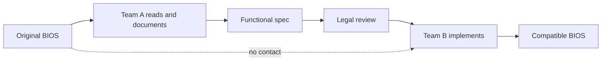
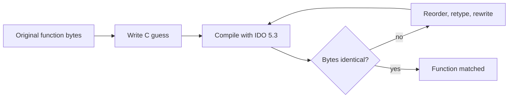

## Table of contents

## Introduction

For seven years, GTA Online made PC players stare at a six-minute load screen. In February 2021 one of them, t0st, opened the game in a disassembler. They had no source code, no debug symbols, and nobody at Rockstar to ask. A weekend later the load time was down by about 70%.

The culprit was two functions grinding one CPU core through a 10 MB JSON file. Rockstar confirmed it, shipped the fix in the next update, and paid t0st a $10,000 bounty.

That's reverse engineering in miniature: nobody will explain the binary, so you ask the machine code directly.

The same craft built the PC clone industry, let Linux talk to Windows file shares, and stopped WannaCry. And over the last six years, reverse engineering games through decompilation and static recompilation turned dozens of console titles into native PC ports running at 4K and 120 FPS. Two of those projects ended in a federal lawsuit and about 200 takedown notices. Others built the same way are still online. Why one gets sued and the other doesn't is a question no court has answered yet, and it's where this post ends up.

## What reverse engineering is

Normal engineering goes from idea to binary: a design becomes source code, and the compiler turns that into machine code. Reverse engineering walks the same road backwards. You start with the binary and rebuild as much of the idea as you need.

"As much as you need" matters. Most reverse engineering never rebuilds a whole program. It answers one narrow question:

- Which function is slow?
- What does this file format look like?
- What does the device send over the wire?
- How does the license check decide?
- What does this malware do once it's running?

A few projects go all the way and rebuild the entire codebase, and those are the ones you read about.

```mermaid caption=Forward compilation loses information that reverse engineering has to recover
flowchart LR
    A[Design and intent] --> B[Source code]
    B -->|Compiler| C[Machine code]
    C -->|Disassembler| D[Assembly]
    D -->|Decompiler| E[Pseudo-C]
    E -->|Human work| F[Readable source]
    F -.->|Docs, names, types| A
```

Every step to the right throws something away. The compiler drops variable names, comments, types, struct layouts, and often whole functions it inlined. Coming back, the disassembler is mechanical and nearly lossless, the decompiler guesses, and everything past pseudo-C is people with a lot of patience.

## The layers you climb through

### Machine code to assembly

A disassembler decodes bytes into instructions. On fixed-width architectures like MIPS or ARM64 this is almost trivial. On x86, with variable-length instructions and data mixed into code sections, the disassembler has to decide where instructions start, and a wrong guess cascades.

Here is a small function and what `gcc -O2` makes of it:

```c file=sum.c
int sum(const int *values, int count) {
    int total = 0;
    for (int i = 0; i < count; i++) {
        total += values[i];
    }
    return total;
}
```

```bash
gcc -O2 -c sum.c && objdump -d --no-show-raw-insn -M intel sum.o
```

```text
sum:
    test   esi,esi
    jle    .L4
    movsxd rsi,esi
    lea    rdx,[rdi+rsi*4]
    xor    eax,eax
.L3:
    add    eax,DWORD PTR [rdi]
    add    rdi,0x4
    cmp    rdi,rdx
    jne    .L3
    ret
.L4:
    xor    eax,eax
    ret
```

`i` is gone. The compiler turned the index into a pointer walking the array and an end pointer to compare against. The names `values`, `count`, and `total` exist only as registers `rdi`, `esi`, and `eax`. Nothing in this listing says "sum". In a stripped release binary even the label is gone, and you'd see `sub_401130`.

### Assembly to pseudo-C

A decompiler lifts instructions into an intermediate representation, recovers control flow (this jump plus that compare is a loop), propagates types, and prints C-like code. Ghidra on the function above produces something like:

```c
int FUN_00101130(int *param_1, int param_2) {
  int *piVar1;
  int iVar2;

  if (param_2 < 1) {
    return 0;
  }
  piVar1 = param_1 + param_2;
  iVar2 = 0;
  do {
    iVar2 = iVar2 + *param_1;
    param_1 = param_1 + 1;
  } while (param_1 != piVar1);
  return iVar2;
}
```

Correct, and almost readable. Now picture 40,000 of these, nameless, calling each other through vtables, with every struct reduced to `*(int *)(param_1 + 0x4c)`.

### Pseudo-C to understanding

Nearly all the time goes here. You rename `param_1` to `vehicle`. You notice offset `0x4c` is always compared to a float that looks like speed, so you add a `speed` field to a struct, and fifty other functions suddenly read better. Each name you give makes the next one easier.

A few things give you a foothold:

- Strings. Error messages, asserts, file paths, and log formats are the first thing to search. A function that references `"Failed to load %s.ydr"` loads a model.
- Imports. Calls into the OS or known libraries are named even in stripped binaries. Whatever calls `CreateFileW` and then `ReadFile` reads a file.
- Known libraries. Statically linked zlib, Lua, or a C runtime can be fingerprinted and auto-named. Ghidra and IDA both ship signature databases for this.
- Debug leftovers, like a symbol file left on a disc, an RTTI table, or a debug build shipped by accident. Several of the projects below exist only because somebody forgot to strip one file.

## Static and dynamic analysis

You can read a binary or you can run it, and real work keeps switching between the two.

| | Static | Dynamic |
| --- | --- | --- |
| What you do | Read the code without running it | Run it and watch |
| Tools | Ghidra, IDA, Binary Ninja, radare2 | x64dbg, gdb, WinDbg, Frida, profilers |
| Sees | Every path, including ones never taken | Only paths that actually execute |
| Struggles with | Obfuscation, packed code, indirect calls | Anti-debugging, rare branches, timing |
| Best for | Structure, file formats, algorithms | Runtime values, hot paths, protocols |

Running the code is often the faster way in. Hook a function, log its arguments, and ten minutes teach you more than an hour of reading. Frida injects a JavaScript engine into a running process for exactly this:

```javascript file=hook-fopen.js
// frida -n game.exe -l hook-fopen.js
const fopen = Module.getExportByName(null, "fopen");

Interceptor.attach(fopen, {
  onEnter(args) {
    this.path = args[0].readUtf8String();
  },
  onLeave(result) {
    console.log(`fopen("${this.path}") -> ${result}`);
  },
});
```

Run the game, open a menu, and the console lists every file it opens, in order. Half the work of cracking a file format is already done.

:::info
For managed runtimes most of this is unnecessary. .NET and Java bytecode keep type and method names, so dnSpy, ILSpy, or JADX give you near-original source in seconds. Unity games built with Mono are trivially readable, which is why IL2CPP exists, and why Il2CppDumper exists right after it.
:::

## The toolkit

| Tool | Kind | Notes |
| --- | --- | --- |
| [Ghidra](https://github.com/NationalSecurityAgency/ghidra) | Disassembler, decompiler | Released by the NSA in 2019, free, scriptable in Java and Python. The default for most hobby projects now |
| IDA Pro | Disassembler, decompiler | The industry standard for 30 years, expensive, the best x86 decompiler for a long time |
| Binary Ninja | Disassembler, decompiler | Clean API, good intermediate languages, popular for automation |
| radare2 / Cutter | Disassembler | Open source, terminal-first, Cutter adds a GUI |
| x64dbg, gdb, WinDbg | Debuggers | Breakpoints, memory inspection, stepping |
| [Frida](https://frida.re) | Dynamic instrumentation | Hook functions at runtime from JavaScript, on desktop and mobile |
| Wireshark | Network analysis | Protocol reverse engineering starts with a packet capture |
| dnSpy, ILSpy, JADX | Managed decompilers | .NET and Java/Android, near-lossless |

Ghidra's release in March 2019 changed who could do this work. Before it, a serious decompiler meant an IDA license costing thousands of dollars. Most of the community game decompilation projects below started, or sped up, after Ghidra became free.

## Case: the clean room BIOS

The IBM PC shipped in 1981 with a published hardware design and one proprietary piece: the BIOS, about 8 KB of firmware that every program used to talk to the hardware. Apple v. Franklin (1983) had just established that firmware is protected by copyright. Copy the BIOS and IBM sues you, which it did to Corona, Eagle, and others.

Compaq and then Phoenix Technologies solved it with a clean room. One team studied IBM's BIOS and wrote a specification describing exactly what each routine did, without any code in it. Lawyers reviewed the spec. A second team, who had never seen IBM's code, implemented it. Phoenix reportedly picked an engineer whose background was on the TI TMS9900, not Intel, to make the separation impossible to dispute.



The Phoenix BIOS went on sale in 1984, and from then on anyone could build a PC compatible without writing their own firmware. That's a big part of why clone makers multiplied so fast in the mid-80s. Phoenix later caught competitors copying *its* BIOS the obvious way: they'd copied Phoenix's bugs too.

:::success
Clean room design protects against copyright claims, because independent creation isn't copying. It does nothing against patents, where independent invention is no defense, and that limit still applies to every clean room project today.
:::

## Case: Samba and the Windows protocols

In 1991 Andrew Tridgell wanted his Unix machine to share files with DOS PCs. There was no specification for the protocol, so he captured packets and wrote a server that answered them the same way. That became Samba, and for most of the next two decades it was how anything that wasn't Windows talked to a Windows network.

This is protocol reverse engineering, a different discipline from reading binaries. You never open the client. You watch the wire, guess, send a crafted packet, and see how the real server reacts. Tridgell later argued "reverse engineering" was the wrong word, since the team treated Windows as a black box. Fair point: people now hear the term and picture only a disassembler.

The story ended in court, though nobody sued Samba. In 2004 the European Commission ordered Microsoft to document its workgroup protocols for competitors. Microsoft lost its appeal in 2007, and the Samba team got the full documentation for a one-time fee of €10,000, free to publish their source code. For sixteen years, packet captures did the job that regulators eventually made Microsoft do on paper.

## Case: Sega, Sony, and the emulator rulings

Two US appeals court rulings define what reverse engineering for compatibility means legally, and both came out of game consoles.

**Sega v. Accolade (1992).** Accolade disassembled Genesis cartridges to find the bytes a game needed for the console to accept it, then shipped its own unlicensed games. Sega won in district court. The Ninth Circuit reversed, holding that disassembly to reach unprotected functional elements, when it's the only way to get them, is fair use.

**Sony v. Connectix (2000).** Connectix copied the PlayStation BIOS repeatedly while building Virtual Game Station, an emulator for the Mac, though the shipped product contained none of Sony's code. Sony won an injunction, and the Ninth Circuit reversed it again: the intermediate copies made during reverse engineering were fair use, and the emulator was a transformative product. Bleem, a commercial PlayStation emulator for Windows, won its own early rounds against Sony and then folded under legal costs anyway.

| Case | Year | Question | Outcome |
| --- | --- | --- | --- |
| Apple v. Franklin | 1983 | Is firmware copyrightable? | Yes, which made the clean room necessary |
| Sega v. Accolade | 1992 | Is disassembly for compatibility legal? | Fair use |
| Sony v. Connectix | 2000 | Are intermediate copies during emulator development legal? | Fair use |
| Take-Two v. re3 developers | 2021 | Is a reconstructed game codebase legal to publish? | Repos removed, no public ruling |

:::warn
These rulings protect the *process* of studying code for interoperability. They don't protect distributing something that reproduces the original code. That gap is exactly where the game decompilation projects below live, and why most of them insist you supply your own copy of the game.
:::

## Case: GTA Online and the six-minute load screen

Back to t0st. A stack-sampling profiler showed GTA Online pinned to one core for minutes during load. The disassembly showed two problems in the code that parsed a 10 MB JSON catalog of about 63,000 store items.

The first was in parsing. The game tokenized the JSON with `sscanf`, and the C runtime's `sscanf` calls `strlen` on its input every time it's called. The input was the rest of a 10 MB buffer:

```c
// Simplified shape of the bug: each sscanf call scans the remaining
// buffer with strlen, so parsing n tokens costs O(n * buffer_size).
while (*p) {
    sscanf(p, "%d", &value);   // strlen(p) inside, every iteration
    p = skip_token(p);
}
```

The second was in deduplication. Before inserting each item, the game scanned every item already inserted, even though each one carried a unique hash. 63,000 items checked against each other is close to two billion comparisons.

```c
// O(n²): linear scan over everything inserted so far, per item.
for (int i = 0; i < count; i++) {
    if (items[i].hash == item.hash) return;
}
items[count++] = item;
```

The patch was a DLL that cached the `strlen` result and skipped the duplicate check, written entirely from the outside. Rockstar confirmed the analysis, patched both issues in March 2021, and paid out through its bug bounty, which normally only covers security bugs.

I think this is the most useful kind of reverse engineering for most of us. Nothing gets rebuilt. You just answer "why is this slow" for code nobody will hand you.

## Case: re3 and reVC, GTA from the inside out

The re3 project rebuilt the full source code of GTA III, and reVC did the same for Vice City. The clever part is how: the game never stopped working while they did it.

They started with the original executable and a DLL injected into it. Each original function they reverse engineered got rewritten in C++, and the DLL redirected calls from the original address to the new implementation. The game kept running the entire time, half original machine code and half reconstructed source, and every function could be tested in place by playing. When the last original function was replaced, the DLL became a standalone executable.

```mermaid caption=Incremental replacement keeps the game playable throughout
flowchart LR
    A[Original exe] --> B[Hook DLL]
    B --> C{Function reversed?}
    C -->|yes| D[New C++ implementation]
    C -->|no| E[Original machine code]
    D --> F[Running game]
    E --> F
```

The result fixed long-standing bugs, removed the framerate cap, added widescreen, and ran on Linux, macOS, Switch, PS Vita, and Wii U. You still needed the original game for every asset.

In February 2021 Take-Two filed a DMCA takedown against the repositories and around 200 forks. A fork owner filed a counter-notice, Take-Two didn't respond in time, and GitHub restored everything. In September 2021 Take-Two sued the developers in federal court in California, and the repositories went down again. The developers argued fair use, pointing at the bug fixes and new platforms. As far as public records show, there was no ruling on the merits, and the code has stayed off GitHub since.

## Case: Super Mario 64 and the matching decompilation

GTA used the hook approach. The N64 community took a stricter one: **matching decompilation**.

The target is C code that, compiled with Nintendo's own compiler (SGI's IDO 5.3 for Mario 64) and the same flags, produces a byte-identical ROM. Behaving the same is not enough. Every function gets rewritten until its compiled output matches the original instruction for instruction.



It's obsessive, and in return you get proof: a matching function has the same logic as the original, so nobody slipped in an off-by-one, changed float precision, or quietly removed undefined behavior. Tools like `asm-differ` show instruction-level diffs, and `decomp-permuter` randomly mutates C source overnight looking for a variant that matches the register allocation.

The SM64 decompilation went public in 2019. In May 2020 a PC port appeared, built from it with a new rendering backend in place of the N64's graphics microcode. It ran natively on Windows and Linux at any resolution and in widescreen, and within weeks people were modding in ray tracing. Nintendo went after distributed builds and videos, but the decompilation itself, which contains no Nintendo assets and requires your own ROM, stayed up.

After Mario, the rest followed:

- **Ocarina of Time** was decompiled by the Zelda Reverse Engineering Team in November 2021 after 21 months. Four months later, in March 2022, Harbour Masters released **Ship of Harkinian**, a native port built on `libultraship`, a reimplementation of the N64 SDK on modern hardware. It extracts assets from your ROM into an `.otr` archive and runs on Windows, Linux, macOS, Switch, Wii U, and Android.
- **Diablo** was rebuilt in 2018 as Devilution, using a symbols file accidentally left on the Japanese PlayStation disc plus a debug build hidden inside the PC game's own data archives. Its successor, DevilutionX, runs on just about anything with a screen.
- **Pokémon**: the pret organization has disassemblies and decompilations of nearly every mainline game from Red/Blue to HeartGold/SoulSilver and Platinum, and the ROM hacking scene now runs largely on them.
- **Later decomps:** Mario Kart 64, Star Fox 64, Twilight Princess, Banjo-Kazooie, Silent Hill, Kingdom Hearts 358/2 Days, and dozens more followed, with ports either released or in progress through 2025 and 2026.

:::info
A finished decompilation is not a port. It's source code that rebuilds the original ROM for the original console. Turning it into a PC game means replacing the graphics, audio, input, and file layers, which is a separate project somebody has to volunteer for. Several games have complete decomps and still no port.
:::

## Case: static recompilation, skipping the decompile

Matching decompilation takes years per game. In May 2024 a developer named Mr-Wiseguy released **N64Recomp**, which skips that. It translates every MIPS instruction in the ROM straight into equivalent C, mechanically, and doesn't care whether anyone can read the result.

```c
// What static recompilation produces: correct, compilable, unreadable.
void func_80024A10(uint8_t* rdram, recomp_context* ctx) {
    ctx->r2 = MEM_W(ctx->r4, 0x4C);
    ctx->r3 = ADD32(ctx->r2, 1);
    MEM_W(ctx->r4, 0x4C) = ctx->r3;
    if ((int32_t)ctx->r3 < 0x10) goto L_80024A30;
    ...
}
```

Compile that with a modern compiler and you have a native executable that does exactly what the N64 CPU would have done, with no emulator interpreting instructions at runtime. Graphics go through RT64, a renderer that translates N64 display lists to Direct3D 12 or Vulkan, which is where the widescreen, high framerate, and ray tracing come from.

The first release was **Zelda64Recomp**, Majora's Mask as a native PC game. Mario Kart 64, Star Fox 64, and Banjo-Kazooie followed through 2025 and early 2026. The same idea hopped to the Xbox 360, translating PowerPC instead of MIPS: Sonic Unleashed shipped as UnleashedRecomp in 2025, and recompiled Blue Dragon, Kameo, and Viva Piñata followed in 2026.

| Approach | Output | Time per game | Readable? | Modding |
| --- | --- | --- | --- | --- |
| Emulation | Interpreter or JIT at runtime | Once per console | N/A | Limited, memory patching |
| Static recompilation | Machine-translated C | Weeks to months | No | Hooks at function level |
| Matching decompilation | Human-written C, byte-exact | Years | Yes | Anything |
| Non-matching decompilation | Human-written C, behavior-equivalent | Months to years | Yes | Anything, with some risk |

Static recompilation trades understanding for speed. You get a native port, and nobody knows what `func_80024A10` does. When a mod has to change behavior, people go back to the decompilation.

## Case: Asahi Linux and the M1 GPU

Not every famous project is a game. Apple shipped the M1 in 2020 with zero public documentation for its GPU, so Linux on Apple Silicon had nothing to draw with.

Alyssa Rosenzweig reverse engineered the GPU's instruction set and command stream by running Metal workloads under macOS and studying what reached the hardware. The resulting open source driver for Asahi Linux became the first conformant OpenGL ES 3.1 implementation for M1 and M2 in 2023, on any operating system. Honeykrisp, the Vulkan driver, followed as the first conformant Vulkan on Apple hardware, and the full stack moved upstream into Mesa 25.2.

A conformant driver passes Khronos's official test suite. Apple ships Metal and has never shipped Vulkan, so the first conformant Vulkan driver for its GPUs came from outside the company, written by someone working from observation alone.

## Case: WannaCry and the kill switch

Malware analysis is reverse engineering under a deadline. In May 2017 the WannaCry ransomware spread across hundreds of thousands of machines in a day, including large parts of the UK's NHS. Marcus Hutchins, picking apart a sample, noticed it tried to connect to a long, unregistered, nonsense domain before encrypting anything, and stopped if the connection succeeded. He registered the domain for about $11. Every new infection checked in, found it alive, and quietly exited.

People still argue whether the check was a deliberate kill switch or clumsy sandbox detection. Either way, it was found by reading a sample in a disassembler until one odd branch made sense.

## Where reverse engineering stops

Some walls the tools can't get through, at least not cheaply.

- **Code that never reaches you.** Matchmaking, economy, and anti-cheat logic for online games mostly runs on servers. You can map what the client sends and receives, but the decisions happen somewhere you'll never see.
- **Virtualizing obfuscators.** VMProtect, Themida, and similar tools rewrite functions into bytecode for a custom virtual machine with its own random instruction set. Every protected function needs that VM reversed first. Most people stop here.
- **Anti-tamper and anti-debug.** Denuvo-style protection and kernel-level anti-cheat detect debuggers and hooks, and punish them with crashes or bans. Dynamic analysis turns into a fight before it starts.
- **Encrypted firmware.** When a boot ROM decrypts code with a key burned into the chip, there's nothing to disassemble until someone extracts the key, usually through a hardware attack.
- **Cost.** A matching decompilation of a large modern game, with millions of lines of C++, templates, and link-time optimization, is far out of reach for a volunteer team. That's why decompilation lives on the N64, PlayStation, and GameCube, and why static recompilation is spreading to newer consoles first.

## Is it legal?

It depends on where you are, what you do with the result, and what you publish. Not legal advice, but the general shape:

- **Studying a binary you own** for interoperability is broadly protected in the US (Sega, Connectix, DMCA §1201(f)) and the EU (Article 6 of the Software Directive). Clauses in the EULA that forbid reverse engineering may still be enforceable in the US.
- **Circumventing copy protection** is a separate offense under DMCA §1201, with narrow exemptions for interoperability, security research, and preservation, renewed every three years.
- **Publishing a reconstructed codebase** is where it gets risky. Matching decompilations are mechanically derived from the original, and a court could easily view them as a derivative work. Take-Two sued over re3. Nintendo has generally targeted distributed builds rather than the decomp repos. Nobody has a ruling.
- **Distributing assets** is plainly infringement, which is why every serious project ships code only and extracts assets from a copy you supply.
- **A clean room reimplementation** is still the safest route to a reimplementation you can defend, if you can afford two teams and a lawyer.

:::danger{title="Leaked source changes everything"}
Using leaked source code, even just to look at it, contaminates a project. Most decompilation communities ban anyone who has seen a leak from contributing, because one function copied from a leak hands the rights holder an easy argument against the whole thing. When Nintendo's internal "gigaleak" hit in 2020, several N64 projects made a point of refusing to touch it.
:::

## AI and the next wave

In 2026 the community argues about AI. LLMs handle the tedious middle well: naming variables, guessing struct layouts, turning Ghidra output into plausible C. Several ports this year were built mostly by AI agents, and decompilation project lists now mark them with AI disclosures.

The pushback came from inside. One of the developers behind the Banjo-Kazooie port called AI-generated ports "a race to the bottom" and "disrespectful" to people who spent years matching functions by hand. The technical objection hits harder. Matching decompilation exists to prove equivalence, and code that merely "looks right" proves nothing. But the byte-for-byte check works on AI output too. My bet: the model ends up as one more generator inside the same compile-and-diff loop a human already uses.

## Where to start

The best first project is one where you already care about the answer.

1. **Pick a small target.** A crackme, an old DOS game, a file format from a tool you use. Not a 200 MB AAA executable.
2. **Run `strings` and `file` first.** Five seconds, and you know the compiler, the libraries, and half the error messages.
3. **Load it in Ghidra** and let auto-analysis finish. Search for an interesting string, find its cross-references, and start renaming from there.
4. **Go dynamic early.** Set a breakpoint on the function you think matters and check if it's hit. It's often faster to confirm a guess than to prove it statically.
5. **Write things down.** Names, struct layouts, and notes are the real output. If they only live in your head, you'll redo the work next week.

For games specifically, the N64 and GBA decomp communities are the friendliest on-ramps. The projects are public, the tooling (`splat`, `asm-differ`, `decomp-permuter`, `decomp.me`) is excellent, and there are always unmatched small functions waiting for someone to take a first stab.

## FAQ

<details><summary>What's the difference between disassembly and decompilation?</summary>
Disassembly turns machine code into assembly instructions, one to one and nearly lossless. Decompilation goes further and reconstructs higher-level code, loops, conditionals, function calls and types, from those instructions. Disassembly is mechanical. Decompilation involves guessing, and the output always needs human cleanup to read like real source.
</details>

<details><summary>Why does a matching decompilation need the original compiler?</summary>
Because the same C compiles to different machine code on different compilers, and even different versions of the same compiler. To prove that reconstructed source is equivalent to the original, you compile it with the exact toolchain the developers used and compare bytes. For N64 games that's usually SGI's IDO or an old GCC, run today through a recompiled or emulated build.
</details>

<details><summary>Is static recompilation the same as emulation?</summary>
No. An emulator translates instructions while the game runs, either interpreting them or JIT compiling. Static recompilation translates the whole program ahead of time into C, which a modern compiler turns into a native executable. No emulator runs at play time. The hardware the code expects, graphics, audio, and input, still has to be reimplemented around it.
</details>

<details><summary>Can I reverse engineer an online game?</summary>
Technically, yes, the GTA Online fix proves it. Legally and practically, the terms of service usually forbid it, anti-cheat may flag a debugger or injected DLL and ban the account, and anything that touches the network protocol can be treated as cheating. Work on a separate account or an offline build, and don't distribute anything that interacts with live servers.
</details>

<details><summary>Do I need to know assembly?</summary>
Enough to read it, yes. You don't need to write it. A few dozen instructions cover most of what you'll see: moves, loads and stores, arithmetic, compares, jumps, calls. Learn the calling convention of your target platform (which registers hold arguments and the return value) and the decompiler output will start making sense quickly.
</details>

## Conclusion

Reverse engineering looks the same at every scale. t0st wanted to know why a load screen was slow and read two functions. Phoenix needed to know what a BIOS did and wrote it down for a team that wasn't allowed to look. The N64 decomp community wanted the source itself, so they kept rewriting functions until the bytes matched.

The tools changed the economics. Ghidra made decompilers free, matching workflows made correctness provable, static recompilation made native ports a matter of months, and AI is now pressing on the parts that were still slow. The law has barely moved since Connectix. Studying code is protected, assets belong to someone else, and publishing reconstructed code is still an open fight.

So start with a question you actually want answered. Tonight, open [decomp.me](https://decomp.me), pick a small unmatched N64 function, and try to make the bytes line up. Or load any binary you own into Ghidra, search for one string, and follow its cross-references. The first time you rename one function and fifty others start making sense, you'll understand why people spend years on this.
